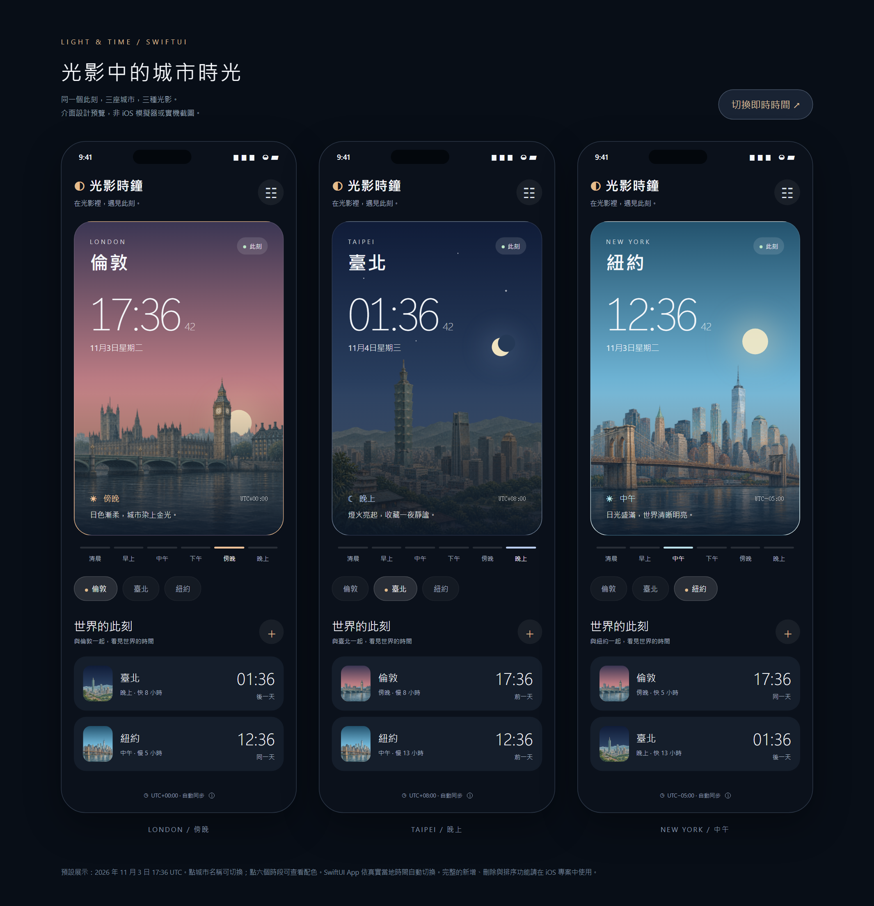

# 光影時鐘｜光影中的城市時光

一個用城市風景與六種光影感受世界時間的 SwiftUI iOS App。第一版初始收藏為倫敦、臺北、紐約，所有時間取自真實的同一個當下。



## 在 Mac 上開啟

1. 解壓縮整個 `WorldTime` 資料夾。
2. 使用 **Xcode 15 或更新版本**開啟 `WorldTime.xcodeproj`。不需要安裝套件或執行專案產生器。
3. 上方選擇 **WorldTime** scheme，以及一台已安裝 **iOS 17 或更新版本**的 iPhone 模擬器。
4. 按 **⌘R** 建置並執行；按 **⌘U** 執行測試。

若要安裝到自己的 iPhone，請在 **Signing & Capabilities** 選擇你的 Team，並把 `com.example.LightAndTime` 改為自己的唯一 Bundle Identifier。模擬器不需要 Apple 開發者簽章。

**交付時的驗證限制：**這次工作環境是 Windows，沒有 Swift、Xcode 或 iOS SDK，因此沒有實際編譯 iOS App、啟動模擬器，或執行 XCTest。已通過的檢查與待在 Mac 上完成的驗證列於 [驗證報告](Documentation/VALIDATION.md)。這份交付包含可供 Xcode 建置的完整原始專案，不含已簽署的 `.ipa`。

## 已實作的第一版功能

- 首頁顯示城市中英文名稱、24 小時當地時間（含秒）、日期、星期、UTC 時差與當前時段。
- 倫敦、臺北、紐約各有一張透明的手繪風景；六種天空、日月及城市色調由 SwiftUI 疊合呈現。
- 點選城市籤或下方列表即可切換首頁城市。
- 所有城市共用同一個時間點；由 IANA 城市時區與 Foundation 處理日期、夏令時間及半小時／45 分鐘時區。
- 列表的「快／慢幾小時」及「前一天／同一天／後一天」均相對於首頁城市。
- 可從全球 186 座城市搜尋新增；清單依地區分組，支援中文、英文、國家與時區名稱搜尋，也接受「台北／臺北」與不帶重音的英文寫法。
- 右上角可管理收藏：刪除、拖曳排序、選擇首頁城市。至少保留一座城市，防止空白首頁。
- 收藏順序與選定城市儲存在裝置的 UserDefaults，關閉重開後恢復。無帳號、定位或網路需求。
- 回到前景或系統時間大幅變動時會重建時鐘更新排程。
- 畫面提供 VoiceOver 標籤、選取狀態及減少動態效果支援。

## 六個時段

| 當地時間 | 主題 | 色彩方向 |
| --- | --- | --- |
| 05:00–06:59 | 清晨 | 薰衣草紫、柔粉晨光 |
| 07:00–10:59 | 早上 | 霧青、暖白陽光 |
| 11:00–13:59 | 中午 | 澄藍、清亮日光 |
| 14:00–16:59 | 下午 | 灰綠、溫暖奶油色 |
| 17:00–18:59 | 傍晚 | 紫暮、蜜桃金色 |
| 19:00–04:59 | 晚上 | 深靛藍、月光銀色 |

這是依鐘面時間切換的插畫主題，不是天文日出／日落、即時天氣或實際日照預報。其他 183 座城市使用中性城市剪影；專屬地標插畫目前只有初始三座城市。時區與夏令時間規則取決於裝置的系統時區資料。

## 容易閱讀的程式結構

```text
WorldTime/
  WorldTimeApp.swift          App 入口及共用 CityStore
  Models/
    City.swift               城市資料與內建清單
    DayPeriod.swift          六個時段的規則及文字
    ClockFormatting.swift    時間、日期、時差與跨日
    FavoritesState.swift     收藏資料及恢復規則
  Store/CityStore.swift      畫面狀態與 UserDefaults
  Theme/PeriodTheme.swift    六種天空及光影色票
  Views/
    HomeView.swift           首頁、城市切換及時鐘更新
    CityHeroCard.swift       城市主視覺與大時鐘
    CityScene.swift          天空、日月、城市插畫圖層
    CityTimeRow.swift        其他城市時間列
    PeriodStrip.swift        六時段指示條
    AddCityView.swift        搜尋與加入收藏
    FavoritesView.swift      刪除與排序
    AboutView.swift          時區與時段說明
  Assets.xcassets/            插畫、圖示與色彩
WorldTimeTests/               28 個 XCTest 測試方法
Package.swift                可獨立測試的 Foundation 核心
```

介面用 `VStack`、`HStack`、`ZStack`、`List` 與 `sheet` 組成，沒有外部套件或複雜架構。要增加城市可修改 `CityCatalog.all`；要調整時段範圍修改 `DayPeriod.at(hour:)`；要調整配色修改 `PeriodTheme.forPeriod(_:)`。

`TimelineView` 依指定排程更新畫面；城市時差以指定日期呼叫 `TimeZone.secondsFromGMT(for:)`，而非固定 UTC 數值。參考 Apple 文件：[TimelineView](https://developer.apple.com/documentation/swiftui/timelineview)、[TimeZone.secondsFromGMT(for:)](https://developer.apple.com/documentation/foundation/timezone/secondsfromgmt(for:))。

## 在 Mac 上驗證

可直接用 Xcode 的 ⌘R／⌘U；也可在專案目錄執行：

```bash
bash Scripts/verify-macos.sh
```

此腳本先以 `swift test` 測試 Foundation 核心，再用 `xcodebuild` 建置 iOS Simulator 版本，任何失敗都會停止。若要指定模擬器執行 Xcode 的測試目標，可先用 `xcodebuild -project WorldTime.xcodeproj -scheme WorldTime -showdestinations` 查看可用裝置，再設定：

```bash
DESTINATION='platform=iOS Simulator,id=你的模擬器UUID' bash Scripts/verify-macos.sh
```

若 Xcode 找不到 iOS Simulator SDK，請先在 Xcode 設定安裝相應的 iOS 平台。若命令列指向 Command Line Tools 而非 Xcode，請在 Xcode 的 **Settings → Locations → Command Line Tools** 選擇安裝的 Xcode。

## 不開 Xcode 先看設計

以瀏覽器開啟 [DesignPreview.html](Documentation/DesignPreview.html)。預設以同一時刻展示三座城市，也可以切換即時時間、城市及六個時段色彩。這是視覺參考，並非 SwiftUI 執行結果；正式 iOS 收藏與搜尋功能在 App 原始碼中。

插畫使用內建 imagegen 產生，已保存於專案中。完整生成提示詞及素材位置見 [IMAGE-PROMPTS.md](Documentation/IMAGE-PROMPTS.md)。`Tools/` 是維護與靜態檢查工具，開啟或建置 App 不需要執行它們。
